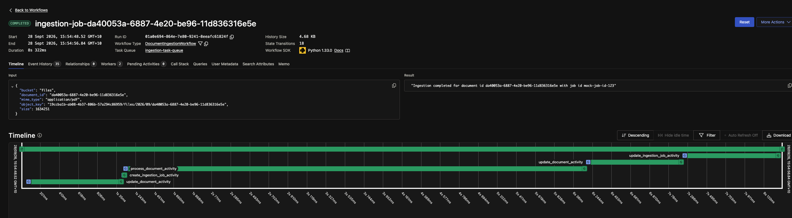

<p align="center">
  
</p>

<h2 align="center">VerityGraph: an agentic GraphRAG pipeline with traceable answers</h2>

<p align="center">
  An event-driven pipeline that ingests documents and will answer multi-hop questions
  with citations back to the source.
</p>

> **Status: learning project, early stage.** The document ingestion path works end to end.
> Parsing, the knowledge graph, vector search and the agent are planned. See the
> [roadmap](#roadmap).

## Contents

- [Why VerityGraph](#why-veritygraph)
- [What works today](#what-works-today)
- [Architecture](#architecture)
- [Getting started](#getting-started)
- [Usage](#usage)
- [Development](#development)
- [Project structure](#project-structure)
- [Roadmap](#roadmap)
- [License](#license)
- [Acknowledgements](#acknowledgements)

## Why VerityGraph

Plain RAG systems often fail at questions that connect several facts, for example: *"How
are the five largest US tech companies investing in each other?"* They retrieve text chunks,
but they do not know how entities relate, and they cannot always show where an answer
comes from.

VerityGraph combines two kinds of retrieval:

- **Semantic search** in a vector database (Qdrant).
- **Relational reasoning** in a knowledge graph (Neo4j).

The goal: a user uploads, for example, several years of SEC 10-K filings and asks a
question. The agent splits the question into steps, queries the graph and the vectors, and
answers with a visual graph. Every node and number links to its source document, page and
text snippet.

## What works today

| Area | Status |
| --- | --- |
| Tenants and users (CRUD API) | Works. The tenant comes from `DEV_TENANT_ID` until authentication exists |
| Presigned upload and download URLs (MinIO) | Works |
| Upload event → Kafka → Temporal ingestion workflow | Works. It records the document and an ingestion job |
| Parsing, chunking, embeddings | Planned. The processing step only downloads the file |
| Knowledge graph (Neo4j), vector search (Qdrant) | Planned |
| Agent (LangGraph), MCP tools, evaluation, tracing | Planned |
| Frontend | Vite and React scaffold only |

## Architecture


### Ingestion flow

```text
Client ──POST /api/v1/documents──▶ FastAPI ──▶ presigned PUT URL + required headers
Client ──PUT file (with headers)─▶ MinIO
MinIO  ──s3:ObjectCreated event──▶ Kafka topic "minio-events"
Worker ──consumes event──────────▶ starts Temporal workflow "ingestion-job-<document_id>"
Workflow:
  1. create the document record   (status UPLOADED)
  2. create the ingestion job     (status PENDING)
  3. process the document         (today: download only)
  4. mark the document PROCESSED and the job COMPLETED
     – or both FAILED, if step 3 fails
```

Design decisions:

- **File bytes never pass through the API.** The client uploads directly to object
  storage. The API stays small and cheap to scale.
- **Temporal owns the long-running work.** Each step is an activity with its own retry
  policy. Data errors are not retried; database and network faults are.
- **At-least-once delivery.** The Kafka consumer commits an offset only after the workflow
  has started. The deterministic workflow ID makes duplicate events harmless.
- **Ports and adapters.** The domain defines `Protocol`s for storage and repositories, and
  the infrastructure layer implements them. Tests replace them with mocks.

### Built with

In use: [FastAPI](https://fastapi.tiangolo.com/), [SQLAlchemy](https://www.sqlalchemy.org/)
and [Alembic](https://alembic.sqlalchemy.org/) on [PostgreSQL](https://www.postgresql.org/),
[MinIO](https://min.io/), [Apache Kafka](https://kafka.apache.org/) (KRaft) with
[aiokafka](https://aiokafka.readthedocs.io/), [Temporal](https://temporal.io/),
[uv](https://docs.astral.sh/uv/), [Ruff](https://docs.astral.sh/ruff/) and
[pytest](https://pytest.org/).

Planned: [Docling](https://docling.ai/), [Qdrant](https://qdrant.tech/),
[Neo4j](https://neo4j.com/), [LangGraph](https://www.langchain.com/langgraph),
[Qwen](https://qwen.ai/home), [React](https://react.dev/) with
[D3.js](https://www.react-graph-gallery.com/).

## Getting started

### Prerequisites

- Docker with Docker Compose v2
- [uv](https://docs.astral.sh/uv/getting-started/installation/) (it installs Python 3.14)
- `make`

### Installation

1. Clone the repository and go to its root directory.
2. Create the two local environment files from the examples:

   ```sh
   cp docker/.env.example docker/.env
   cp backend/.env.example backend/.env
   ```

3. Replace every `<YOUR-PASSWORD>` and `<YOUR-CLUSTER-ID>` value.
   - Make the MinIO and Postgres credentials in `backend/.env` the same as in `docker/.env`.
   - Generate a Kafka cluster ID with
     `docker run --rm confluentinc/cp-kafka:8.3.1 kafka-storage random-uuid`.
4. Install the backend dependencies:

   ```sh
   make install
   ```

5. Start the stack:

   ```sh
   make up
   ```

### Services

| Service | URL or port |
| --- | --- |
| API (OpenAPI docs) | <http://localhost:8000/docs> |
| Temporal Web UI | <http://localhost:8081> |
| Kafka UI | <http://localhost:8080> |
| MinIO console / S3 API | <http://localhost:9001> / `localhost:9000` |
| pgAdmin | <http://localhost:5433> |
| PostgreSQL (app / Temporal) | `localhost:5432` / `localhost:5435` |
| Kafka (from containers / from the host) | `kafka-kraft:9092` / `localhost:9094` |

## Usage

Do these steps to upload a document and start the ingestion:

1. Request an upload URL:

   ```sh
   curl -s -X POST http://localhost:8000/api/v1/documents \
     -H "Content-Type: application/json" \
     -d '{"filename": "report.pdf", "namespace": "filings"}'
   ```

   The response contains `document_id`, `url` and `required_headers`.

2. Upload the file with every header from `required_headers`:

   ```sh
   curl -X PUT --upload-file report.pdf \
     -H "x-amz-meta-tenant-id: <value>" \
     -H "x-amz-meta-filename: report.pdf" \
     -H "x-amz-meta-document-type: PDF" \
     "<url>"
   ```

3. Open the Temporal Web UI. Find the workflow `ingestion-job-<document_id>`.

   

4. Request a download URL:

   ```sh
   curl -s http://localhost:8000/api/v1/documents/<document_id>
   ```

Other endpoints: `POST/GET/PATCH/DELETE /api/v1/tenants/{tenant_id}`,
`/api/v1/users/{user_id}` and `GET /api/v1/info`. The OpenAPI docs list all of them.

## Development

| Task | Command |
| --- | --- |
| Run the API locally with reload | `make dev` |
| Run the ingestion worker locally | `make worker` |
| Lint and format check | `make lint` |
| Tests with coverage (CI fails below 95%) | `make test` |
| Lint and tests, the same as CI | `make check` |
| Apply database migrations | `cd backend && uv run alembic upgrade head` |

When you run the API or the worker on the host, set the hosts in `backend/.env` to
`localhost` (Kafka: `localhost:9094`).

The tests need no running services. The workflow tests download the Temporal time-skipping
test server on the first run.

## Project structure

```text
backend/src/
├── api/              # FastAPI routers and dependency providers
├── domain/           # Entities, value objects, services, ports (no framework imports)
├── infrastructure/
│   ├── database/postgres/   # ORM models, mappers, repositories, session
│   ├── storage/minio/       # MinIO adapter for the storage port
│   ├── message_broker/kafka # Event handler, consumer loop, worker entry point
│   └── workflow_execution/temporalio/  # Ingestion workflow and activities
├── libs/             # Settings, logging, enums, schemas, exceptions
├── pipelines/        # Planned: loaders, chunking, embedding, graph, indexing
└── agents/, mcp/, evaluation/, observability/   # Planned (empty)
backend/tests/        # Mirrors src/: api, domain, infrastructure, kafka, workers
docker/               # Compose stack and init scripts
frontend/             # Vite + React scaffold
docs/                 # Documentation and images
```

## Roadmap

1. **Ingestion:** parse documents with Docling, chunk them, and store the chunks with
   their provenance.
2. **Retrieval:** embeddings and vector search in Qdrant.
3. **GraphRAG:** entity and relationship extraction into Neo4j.
4. **Agentic querying:** a LangGraph agent with MCP tools.
5. **Evaluation and observability:** RAGAS, OpenTelemetry tracing.
6. **Production:** authentication (JWT), tenant isolation in every store, deployment.

## License

Distributed under the MIT License. See [LICENSE](LICENSE).

## Acknowledgements

- [SQLAlchemy – ORM Quick Start](https://docs.sqlalchemy.org/en/21/orm/quickstart.html)
- [aiokafka – Kafka client for asyncio](https://aiokafka.readthedocs.io/en/stable/consumer.html)
- [MinIO – Publish events to Kafka](https://docs.min.io/aistor/administration/bucket-notifications/publish-events-to-kafka/)
- [MinIO – Bucket notification guide](https://github.com/minio/minio/blob/master/docs/bucket/notifications/README.md)
- [Temporal – PostgreSQL visibility store](https://docs.temporal.io/self-hosted-guide/visibility/postgresql)
- [Building a scalable, production-grade agentic RAG pipeline](https://levelup.gitconnected.com/building-a-scalable-production-grade-agentic-rag-pipeline-1168dcd36260?sk=847eaad13184d47f2c6a09a9d55e9750)
- [Building enterprise Python microservices with FastAPI](https://blog.devops.dev/building-enterprise-python-microservices-with-fastapi-in-2025-10-10-kafka-saga-choreography-aeb9781b00a6)
- [Setting up a Kafka cluster with Docker Compose (KRaft mode)](https://medium.com/@darshak.kachchhi/setting-up-a-kafka-cluster-using-docker-compose-a-step-by-step-guide-a1ee5972b122)
- [Dead letter queues: what they are and when to use them](https://medium.com/@danthelion/dead-letter-queues-what-they-are-and-when-to-use-them-252c33fb4ced)
- [Running MinIO locally with Docker Compose](https://pliutau.com/local-minio-docker-compose-buckets)
